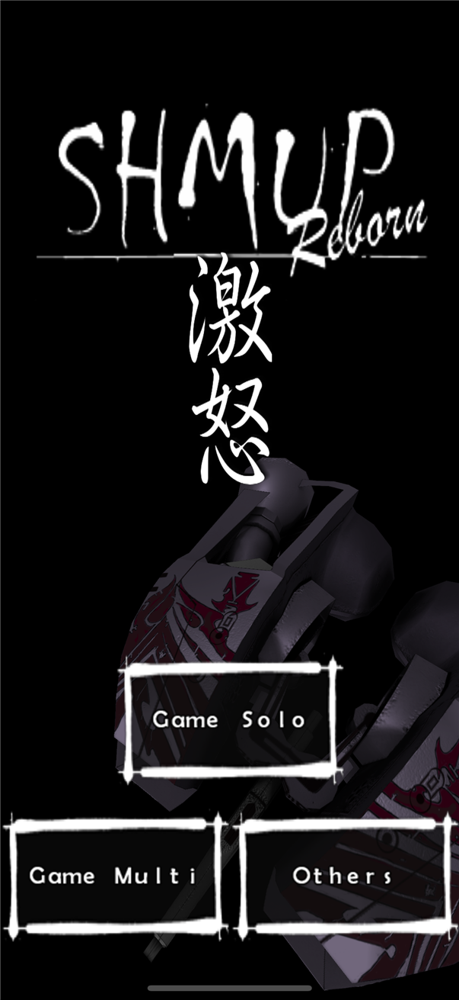

SHMUP Reborn
============

SHMUP is the 3D shoot 'em up Fabien Sanglard wrote in 2009; his page is at
[http://fabiensanglard.net/shmup/](http://fabiensanglard.net/shmup/). SHMUP
Reborn is its modernization for today's iPhones and iPads, free and open source
(GNU GPLv3), released with his agreement: five acts and a final boss,
one-finger controls, multiplayer for two to four over the local network or Game
Center. The game is the same on Windows; Android builds from the same sources.

Technical side
==============

ANSI C, with a thin wrapper per platform. On iOS the game renders with Metal;
the Windows port uses desktop OpenGL. In 2009 it rendered with OpenGL ES 1.1,
with an experimental ES 2.0 path based on the dEngine source
([http://fabiensanglard.net/dEngineSourceCodeRelease/index.php](http://fabiensanglard.net/dEngineSourceCodeRelease/index.php)).

Repository layout
=================

    src/core/          the engine and the game, ANSI C, platform-neutral
    src/backends/      what a platform plugs in: apple/ (Metal renderer,
                       AVFoundation sound and music), gl/ (desktop OpenGL
                       renderer), win/ (waveOut effects, MCI music, WIC
                       PNG, settings), android/ (EGL display, assets,
                       OpenSL), posix/ (stdio filesystem), openal/
    src/third_party/   libpng
    ios/               the Xcode project, app delegate, view, plist, icons
    win/               the Windows port (round 87): win/build.ps1 -> ShmupReborn.exe
                       with zig cc alone; the 2010 Visual Studio project sits
                       beside it as it was
    mac/ linux/        the 2010 ports, kept as they were (not built by CI)
    android/           the Gradle project (android/old: the 2010 one)
    data/              every level, model, texture, sound and music
    tools/             the harnesses and generators the CI runs
    store/             the App Store listing, versioned
    .github/workflows  compile check, smokes, TestFlight, App Store Connect

Enjoy

Copyright (C) 2009 Fabien Sanglard; SHMUP Reborn (C) 2026 Jr Cabbry
